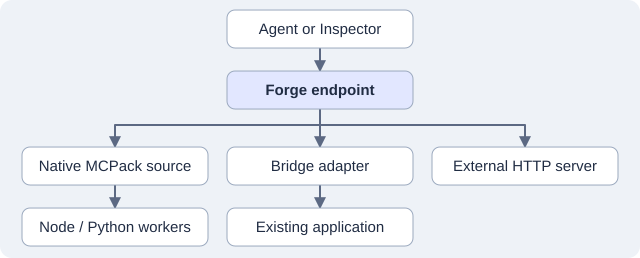

# Modern MCP Forge 0.10.0 developer guide

Forge is a local workbench for building, connecting and testing MCP tools,
static resources and prompts. It publishes the open project's capabilities at
one MCP endpoint. Native sources use `@modern-software/mcpack@0.9.0` from npm;
Forge and MCPack have independent version numbers.

## Contents

- [Install and start](#install-and-start)
- [Choose an implementation](#choose-an-implementation)
- [Create your first native tool](#create-your-first-native-tool)
- [Organize complex implementations](#organize-complex-implementations)
- [Resources and prompts](#resources-and-prompts)
- [Bridge existing applications](#bridge-existing-applications)
- [Connect external servers](#connect-external-servers)
- [Test arguments and results](#test-arguments-and-results)
- [Save repeatable test cases](#save-repeatable-test-cases)
- [Control what agents see](#control-what-agents-see)
- [Reload, diagnose and collaborate](#reload-diagnose-and-collaborate)
- [Export and deploy](#export-and-deploy)
- [Supported boundaries](#supported-boundaries)

## Install and start

Use Bun as pinned by `packageManager` in [package.json](../package.json), Node.js
22 or newer, and Python 3.11 or newer if using Python workers/adapters. The optional
[five-framework lab](../examples/bridges/compatibility-lab/README.md) has its own
requirements: Node 24, Python 3.12 and uv.

For the 0.10.0 rehearsal:

```sh
git clone --branch v0.10.0 https://github.com/ModernSoftware/modern-mcp-forge.git
cd modern-mcp-forge
bun install --frozen-lockfile
bun run dev
```

Before a release tag exists, `v0.10.0` is a development branch, not a published
release. Record `git rev-parse HEAD` when reporting a rehearsal result. After
publication, use the release tag for a reproducible installation.

Open the URL Vite prints (normally `http://localhost:5173`). Create a project in
a folder you own from **Projects**, or open a folder containing
`forge.project.json`. Do not create projects inside Forge's `node_modules`.
Run `bun run runtime:check` if a runtime is not detected.

`bun run dev` checks Forge's frozen lockfile before startup. Your tools and
adapters own separate dependencies and environments; installing Forge does not
install those. With [Docker](docker.md), project paths and interpreters refer
to locations inside the container.

## Choose an implementation

| Source | Use it when | Implementation owner | Native export |
| --- | --- | --- | --- |
| Native MCPack | Authoring capabilities for standalone deployment | Your manifest and Node/Python modules | One source per archive |
| Bridge adapter | An application exposes a registry, dispatcher or framework API | Application plus a project-owned adapter | No |
| Bridge stdio | A local server already speaks MCP over stdio | Existing server entrypoint | No |
| External HTTP | A server runs at a Streamable HTTP MCP URL | Remote service | No |



A project can mix these sources. Source IDs are unique within the project.
Native definitions own their published identities; bridge/external definitions
retain upstream identities and can have local exposure overrides.

## Create your first native tool

1. Choose **Add tool**. Enter `greet_customer`, a description, a new native source
   ID such as `customer-tools`, and the Node runtime.
2. Click **Create tool**. Forge creates a placeholder handler and opens its
   editor. On **Definition**, add a string field named `name`, turn on
   **Required**, enter **Minimum length** `1`, and click **Save definition**.
   Required checks that the property is present. Minimum length also rejects an
   empty string. **Edit as JSON** shows the corresponding schema:

   ```json
   {
     "type": "object",
     "properties": { "name": { "type": "string", "minLength": 1 } },
     "required": ["name"],
     "additionalProperties": false
   }
   ```

3. The project-level `forge.project.json` registers sources. Its top-level
   tools, resources and prompts arrays support classic projects. The native
   workers and their handler bindings are in `native/customer-tools/mcpack.json`.
4. In **Code**, implement the handler:

   ```js
   export function createWorker(context) {
     return {
       tools: {
         async greet_customer({ name }, call) {
           call.signal.throwIfAborted();
           const result = { greeting: `Hello, ${name}!` };
           return {
             content: [{ type: 'text', text: JSON.stringify(result) }],
             structuredContent: result
           };
         }
       }
     };
   }
   ```

5. Save and reload as prompted. In **Test**, enter a name and run it. Check
   Preview and Raw JSON.
6. Connect Inspector to the workspace's `/mcp` URL. Discover and call the same
   tool. Execution history labels MCP client calls, one-off workbench tests and named test case calls.

The manifest binding connects the public tool name to a worker and handler:

```json
{
  "name": "greet_customer",
  "worker": "main",
  "handler": "greet_customer",
  "inputSchema": {
    "type": "object",
    "properties": { "name": { "type": "string", "minLength": 1 } },
    "required": ["name"],
    "additionalProperties": false
  }
}
```

This is one tool entry, not a complete manifest. Start with the generated
manifest. To add a second tool named `greet_customer_py` to the same source,
select **Create a new worker and handler**, give its worker a distinct ID, and choose Python at creation. Match the handler key shown above the
Code editor. For the `greet_customer_py` binding, use:

```python
import json

def create_worker(context):
    def greet_customer_py(args, call):
        call.signal.throw_if_aborted()
        result = {"greeting": f"Hello, {args['name']}!"}
        return {
            "content": [{"type": "text", "text": json.dumps(result)}],
            "structuredContent": result,
        }
    return {"tools": {"greet_customer_py": greet_customer_py}}
```

See [native authoring](native-authoring.md) for existing-worker bindings,
manifest editing, validation and file limits.

### Text and structured tool results

`content` is a list of MCP content blocks, such as text and images.
`structuredContent` carries JSON data that clients can inspect directly and that
named test cases can assert through paths such as `/structuredContent/greeting`.
They are independent fields. Forge preserves both and does not synchronize them.
Build a result once and derive both representations from it, as above.

For compatibility, the MCP specification recommends also returning serialized
JSON in a text block when supplying structured content. A tool can return only
text when structured output is unnecessary. If you declare an `outputSchema`,
its structured result must satisfy that schema. See the
[MCP tool result specification](https://modelcontextprotocol.io/specification/2025-11-25/server/tools#structured-content).

**Use value from last result** captures the selected path exactly. Changing only
`content[0].text` will not change an assertion targeting `structuredContent`.
After changing a tool's input schema, review its saved arguments, save the case,
then update the expected result if the behavior also changed. Case verdicts and
tool execution status measure different things.

## Organize complex implementations

The factory is an integration boundary, not a requirement to put all business
logic in one function. Import services, repositories and helpers from other
modules. Initialize shared clients once in `createWorker`/`create_worker` and
return handlers that delegate to those services. A Node factory can return a
`close` hook to release shared resources.

The [quote worker](../examples/bridges/compatibility-lab/native/quote.mjs) creates
a SQLite catalog once, uses `decimal.js`, returns business errors and closes
its database. The [shipping worker](../examples/bridges/compatibility-lab/native/shipping.py)
uses Python calendar logic and configuration from the
[manifest](../examples/bridges/compatibility-lab/native/mcpack.json).

| Concern | Location |
| --- | --- |
| Public schema and worker binding | MCPack manifest |
| Business logic and helpers | Source directory, edited in your IDE |
| Node dependencies | Source's `package.json` and lockfile |
| Python dependencies | Requirements/project file and selected environment |
| Non-secret settings | Worker `config` in the MCPack manifest |
| Credentials | Process environment and explicit worker `inheritEnv` names |
| Durable business data | Your database or persistent storage |

Workers stay alive between calls, but lose memory on reload, shutdown or failure.
Process persistence is not durable storage. Compile TypeScript before pointing a
native worker at emitted JavaScript. Forge edits declared modules and manifests;
use your IDE for helpers, folders and dependency installation.

## Resources and prompts

Choose **Add resource** or **Add prompt**, then select a source. The same choices
also apply to **Add tool**:

| Implementation | File change | Worker behavior |
| --- | --- | --- |
| **Add a new handler to an existing worker** | Adds a function and its registry entry to the selected module after a preview | Shares the selected worker's runtime, configuration and initialized dependencies |
| **Create a new worker and handler** | Creates a new `.mjs` or `.py` module in this source | Creates a separate worker with its own runtime and state |
| **Use an existing handler** | Adds only a manifest binding | Uses a handler you already implemented |

A **source** is an exportable pack described by one MCPack manifest. A **worker**
is a runtime instance configured to load a module and call its factory. A
**handler** is a function registered under `tools`, `resources` or `prompts` in
the factory's return value. One module can implement all three groups. Different
worker IDs can load the same module, but they still have separate worker state.

For a shared handler, select the worker, choose **Preview handler**, review the
proposed file, then choose **Create resource/prompt/tool**. No extra module or
worker is created. The selected worker's runtime is inherited. Both the manifest
and module revisions are checked before saving. If the module changes in your
IDE, refresh the preview before trying again. Creation restarts sources and
reinitializes worker memory, as other code saves do.

Automatic insertion supports exported Node factories and top-level Python
factories with a single direct object/dictionary return and literal handler
groups, including the generated scaffolds and examples below. It preserves
existing code and comments. Dynamic registries, spreads, decorators or conditional
factory returns may require manual editing. Forge explains unsupported structures
without changing files. Use **Use an existing handler** after implementing the
function yourself, or choose a new worker. Python previews use a local Python
interpreter to parse source, without importing the worker or its dependencies.

Adding an argument later changes the definition, not your existing handler code.
Read prompt values from `args.topic` in Node or `args["topic"]` in Python. Forge
does not rewrite your implementation when its definition changes.

On a resource's **Definition** tab, set its URI and content type. On a prompt's
**Definition** tab, choose **Add argument** and enter its name, description and
required status. **Edit as JSON** edits the full definition and retains the
worker/handler binding. Prompt arguments are a list of declarations, for example
`[{"name":"topic","description":"Subject to review","required":true}]`.

The following are complete factories for an existing shared Node worker. Add the
bindings `guide` under resources and `review` under prompts to its MCPack manifest.
For generated modules, keep the handler names shown above Forge's Code editor.

```js
export function createWorker(context) {
  return {
    resources: {
      async guide({ uri }) {
        return { contents: [{ uri, mimeType: 'text/plain', text: 'Support guide' }] };
      }
    },
    prompts: {
      async review({ topic }) {
        return { messages: [
          { role: 'user', content: { type: 'text', text: `Review ${topic}` } }
        ] };
      }
    }
  };
}
```

The equivalent shared Python worker is

```python
def create_worker(context):
    def guide(args, call):
        return {"contents": [{
            "uri": args["uri"], "mimeType": "text/plain", "text": "Support guide"
        }]}

    def review(args, call):
        return {"messages": [{
            "role": "user",
            "content": {"type": "text", "text": f"Review {args['topic']}"}
        }]}

    return {"resources": {"guide": guide}, "prompts": {"review": review}}
```

Resource reads and prompt retrievals are available in **Test** and through an MCP
client. They do not create tool execution records. Named cases currently apply
to tools only.

### Prompt input and model settings

MCP prompt arguments are named strings. Forge provides synchronized Form and JSON
views for testing native, bridged and external prompts. Required arguments must
be present, and JSON values such as nested objects, numbers and booleans are
rejected before invocation. Empty strings remain strings and may need further
validation in your handler.

A prompt renders messages. It does not set the client's model temperature or
maximum token count. If your application needs structured settings for rendering,
explicitly define a string argument and parse JSON inside that string in your
handler, with application validation. For example

```json
{"topic":"inventory","settings":"{\"temperature\":0.6,\"maxTokens\":1000}"}
```

These are application-specific rendering inputs. The consuming client controls
the actual model configuration. See the
[MCP prompt specification](https://modelcontextprotocol.io/specification/2025-11-25/server/prompts).

### External edits and conflicts

If VS Code saves a worker after you opened it in Forge, saving the old Forge draft
returns a conflict. The disk version remains intact and the draft remains in the
editor. **Copy current draft** preserves your text for a manual merge in your IDE.
**Reload disk version** asks before discarding unsaved edits, reads the latest
files and restarts the sources. Progress remains visible through startup.
Forge does not currently offer an automatic three-way merge.

## Bridge existing applications

If an application serves MCP over HTTP, connect it externally. If it has a stdio
entrypoint, select that bridge mode. Otherwise create a Node/Python adapter that
maps Forge's hooks to its public registry or dispatcher. Forge owns the adapter
host; the developer keeps the application's existing workflow and entrypoint.

The [bridge guide](bridged-sources.md) explains hooks, dependency ownership,
`entrypoint`, `checkoutEnv`, `cwd`, module resolution and cancellation. `cwd` is
the process working directory. It is not a per-tool sandbox and does not make
Node imports resolve from that folder.

The [compatibility lab](../examples/bridges/compatibility-lab/README.md) integrates
FastAPI-MCP, standalone FastMCP, xmcp, Mastra and MCP Framework. Its `client.mjs`
helper is example-specific wiring, not a mandatory Forge API or universal
framework dispatcher.

## Connect external servers

Choose **Connect external server**, enter a name and Streamable HTTP URL, and
choose no authentication or a bearer-token environment-variable name. Set the
raw token in the environment that launches Forge, then restart Forge. Enter
only the variable name in the UI; Forge adds the `Bearer ` prefix.

Enabled connections are discovered before saving. Cancel or correct failed
drafts. **Manage connection** repairs, disables or removes saved sources. An
unavailable upstream leaves healthy sources usable. See
[external connections](external-sources.md) for cross-platform environment setup,
authentication diagnostics, naming and protocol limits.

### Why Inspector sometimes needs reconnecting

MCP supports optional `list_changed` notifications. Forge 0.10.0 builds its
exposed catalog from the current source generation and requires clients to
reconnect after source restarts or exposure changes. A client can otherwise keep
its earlier discovery results. Hiding a capability or changing its alias also
removes the old public identity from Forge's current routing. Reconnect to refresh
discovery, then test the old identity directly to verify rejection.
Automatic catalog notifications are a later enhancement.

## Test arguments and results

The tester uses the running tool's schema for native, bridged and external tools.
Forms support strings, numbers, booleans, enums, objects and arrays within the
supported schema subset. Omit optional properties rather than sending empty values.

**Edit as JSON** edits the same arguments. Valid values survive switching modes.
Incomplete JSON stays editable and disables Run. Unsupported form constructs
fall back to JSON; the tool itself can still run. If local validation is
unavailable, the tester explains that validation is left to the server.

**Populate sample** generates a schema-checked starting object, using valid
published examples where possible. It asks before replacing existing input.
Generation can fail for a schema it cannot satisfy. Sample values do not prove
that a SKU, account or URL exists. Review them before execution.

**Preview** displays structured content, text and supported inline images.
**Raw JSON** shows the complete highlighted MCP result, including metadata and
encoded image data. No output schema is required for preview; it presents data
rather than validating business correctness.

## Save repeatable test cases

Use **Named test cases → Save as case** in a tool's tester. Store arguments, an
expected result mode and exact JSON Pointer assertions. For example, the lab
quote can assert `/structuredContent/total` equals the string `"59.93"`.

**Workspace → Named test cases** filters, selects and runs cases across sources.
Batches are sequential; **Stop after current case** stops the queue after the
active request. Commit `forge.cases.json`; verdicts and timestamps stay in local
SQLite. Read [named test cases](named-test-cases.md) for expected errors, invalid
input, schema drift, hidden tools and reliability limits.

## Control what agents see

For bridge/external items, open **Manage bridge/connection → Discovered catalog →
Agent exposure**. Set a public alias, override a description or turn off
**Expose to agents**. Upstream code and schemas stay unchanged. Local testers
continue using original identities, including hidden items.

Native items use their definitions and enable/disable controls. Hidden/disabled
items are omitted from public discovery and direct Forge invocation is rejected.
Reconnect clients after exposure changes. See [agent exposure](agent-exposure.md)
for collisions and resource URIs.

## Reload, diagnose and collaborate

Use **Reload project sources** after IDE edits. It restarts enabled sources,
refreshes catalogs and invalidates stale requests. Save connection settings
before reloading. Restarts discard process-local state and do not retry calls.
Failed sources remain visible for repair.

Execution history records tool arguments, results, status and origin. Inspect
source configuration for startup errors. A revision conflict means a file
changed since the editor read it; reconcile it before saving. See
[troubleshooting](troubleshooting.md).

Commit manifests, cases, modules, adapters, dependency lockfiles and assets.
Exclude installed packages, virtual environments, builds, credentials and local
databases. Separate application checkouts keep their own source control: document
a compatible revision and a `checkoutEnv` variable. See
[application data](app-data.md) for local state and backups, and
[project workflow](project-workflow.md) for open/close/forget and view persistence.

## Export and deploy

**Export native pack** selects one enabled native source. Choose capabilities
and review deployment files. Add helpers/assets loaded dynamically; static
analysis cannot discover every runtime file. Extract into a clean directory,
install dependencies, validate and run independently of Forge.

The archive contains a pinned MCPack host, rewritten pack manifest, selected
files, dependency declarations and instructions. It excludes Forge, installed
dependencies, named cases, bridges and external sources. Worker environment
literals become inherited-variable references; supply values on the deployment
host. Review code/configuration for embedded secrets.
[Native deployment](native-deployment.md) covers HTTP, stdio and listener settings.

## Supported boundaries

This release supports native Node/Python, Node/Python bridges, static resources,
prompts and external Streamable HTTP. Full OAuth login/refresh, .NET/Go workers,
a visual dependency manager, resource templates/subscriptions, server-initiated
sampling/elicitation and combined external-source deployment are not implemented.
Source controls are not individual-worker controls. Catalog changes require
rediscovery; upstream notifications are not relayed automatically.

Forge executes trusted code with the user's permissions. It is not a sandbox
or a multi-user production gateway. Exposure customizes a shared catalog, not
per-user authorization. Read the [security model](security.md) and use the
[release rehearsal checklist](release-checklist.md) for acceptance.
